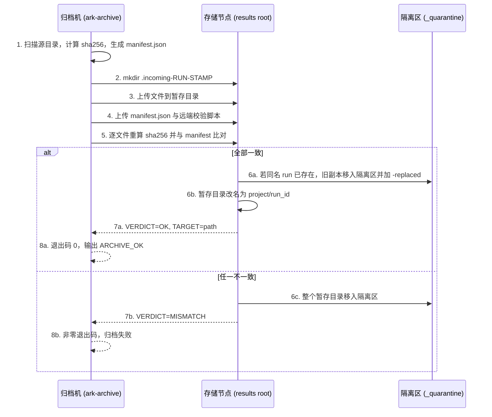

# 归档流程

本文件描述 `ark-archive` 从本地结果目录到集中存储的完整流水线。Linux 入口 `bin/ark-archive.sh` 与 Windows 入口 `bin/ark-archive.ps1` 行为一致，唯一的平台差异是上传工具（`rsync` 对 `scp`）和口令传递方式（`sshpass` / askpass 对 askpass）。

## 目标

把一次 run 的产出可靠地放到 `/srv/storage/ark/results/<node>/<project>/<run_id>`，并留下可校验的 `manifest.json`。核心约束：

- 源目录只读，**复制而不是移动**，归档失败不影响本地结果。
- 文件先落暂存目录，**在存储节点上重算 SHA-256**，全部一致才原子落位。
- 任何不一致都进入隔离区，结果区永远只保留校验通过的副本。

## 逐步流程

### 1. 扫描与计算 manifest

读取 `--source`（Windows 为 `-SourceDir`）目录，遍历所有普通文件（跳过符号链接），逐个计算 `bytes` 与 `sha256`，按相对路径排序。生成 `manifest.json`，字段为：

```
run_id, project, device, node, started_at, ended_at, result,
files[{path, bytes, sha256}], archived_at, source_dir
```

可选字段 `raw_started_at`、`raw_ended_at` 只在来源时间存在且与规范化结果不同时写入。`started_at` / `ended_at` 优先取 `summary_final.json`，缺失时退回文件修改时间，并统一规范化为北京时间契约格式 `YYYY-MM-DD HH:MM:SS`。`archived_at` 由 `lib/ark_time.py` 生成。`result` 缺省时，按 `summary_final.json` 的识别率推断（`>= 0.9` 为 `PASS`，否则 `FAIL`），再不行取状态计数或 `unknown`。

源目录为空时直接失败，不生成空归档。

### 2. dry-run 分支

带 `--dry-run`（Windows 为 `-DryRun`）时，打印目标路径、文件清单、总字节数和 manifest 预览，然后退出。**不建立任何连接，不复制任何文件。**

### 3. 建立远端暂存目录

在存储节点上创建：

```
<results-root>/<node>/<project>/.incoming-<run_id>-<stamp>
```

`<stamp>` 是 `YYYYMMDD-HHMMSS` 形式的文件名时间戳，保证并发归档彼此不冲突。同时清理同名的临时校验脚本。历史下划线形式（`YYYYMMDD_HHMMSS`）的目录只读兼容：不迁移、不改名，新归档一律连字符。

### 4. 上传文件

把源目录内容上传到暂存目录（暂存目录本身即内容根，Linux 与 Windows 统一为平铺结构，不再多套一层 basename）。上传完成后再单独上传 `manifest.json` 和远端校验脚本。

### 5. 远端重算校验

在存储节点上执行 `lib/remote-verify.sh`（由归档入口上传为一次性脚本）。它读取暂存目录里的 `manifest.json`，对每个条目：

- 检查文件是否存在；
- 重新计算 `size` 与 `sha256`；
- 与 manifest 中的 `bytes` / `sha256` 逐条比对。

输出结构化结果：

```
CHECKED=<已校验条目数>
BYTES=<总字节>
VERDICT=OK        # 或 VERDICT=MISMATCH
MISMATCHES=<数量>  # 仅 MISMATCH 时
```

### 6a. 全部一致：落位

- 若目标目录 `<results-root>/<node>/<project>/<run_id>` 已存在，先把旧目录整体移到 `<quarantine-root>/<node>/<run_id>-<stamp>-replaced`。**不覆盖，不合并。**
- 把暂存目录改名为目标目录。同一文件系统内的改名是原子的。
- 修正权限（目录 `2775`、组 `sambashare`），清理空的父级残留。
- 输出 `TARGET=<path>`，归档入口打印 `ARCHIVE_OK`，退出码 `0`。

### 6b. 任一不一致：隔离

- 把整个暂存目录移到 `<quarantine-root>/<node>/<run_id>-<stamp>`。
- 输出 `QUARANTINE=<path>` 与非零退出码，归档入口判定失败。

### 7. 退出

归档入口把远端退出码原样返回。非零即表示本次归档没有成功落位，结果区没有产生新副本。

## 时序图



## 隔离区里有什么

`_quarantine/<node>/` 下有两类目录：

- `<run_id>-<stamp>`：校验失败的上传副本。里面是完整的暂存内容，包含 `manifest.json`，可以直接拿来和本地源目录对比。
- `<run_id>-<stamp>-replaced`：被新版本替换掉的旧归档副本。数据完整，只是不再是当前版本。

隔离区不会被自动清理，需要人工判断后处理。这样做是为了让“失败”始终可查，而不是被静默丢弃。

## 校验失败怎么恢复

1. **不要**手工把隔离目录移回结果区。结果区只接受通过远端校验的副本。
2. 在归档机上用 `--dry-run` 重新跑一次，确认文件清单与 manifest 一致。
3. 排查常见原因：上传中断导致文件截断、源文件在扫描后又被改写、磁盘满、权限不足导致部分文件没有落盘。
4. 修复后重新归档。新副本会走完整校验，旧的隔离目录按需人工删除。
5. 如果确认是源文件本身变化导致 manifest 过期，直接重新归档即可，会生成新的 manifest 和新暂存目录。

## 同名 run 的处理

同一个 `<node>/<project>/<run_id>` 重复归档时，流程不会报错也不会合并：

- 新副本通过校验后，旧目录被移到隔离区并带 `-replaced`；
- 新副本原子落位。

这样结果区永远只有一份“当前有效”的副本，历史副本留在隔离区可追溯。如果不希望替换，归档前先换一个 `--run-id`。
